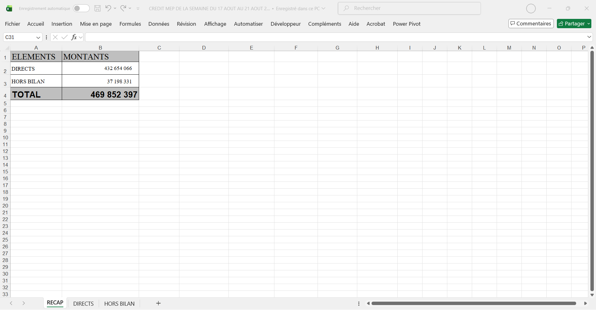
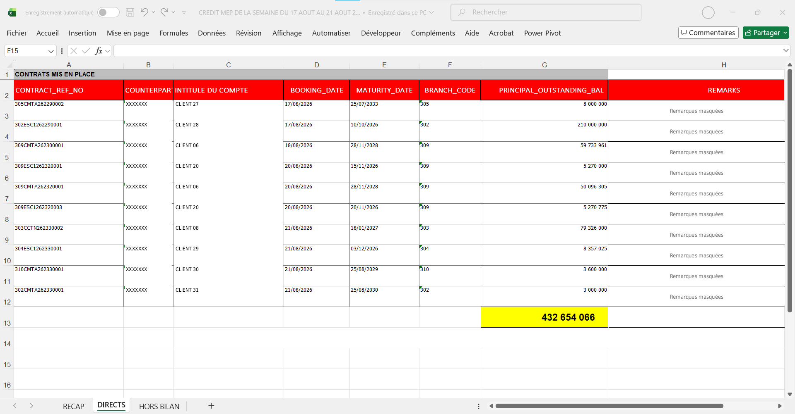
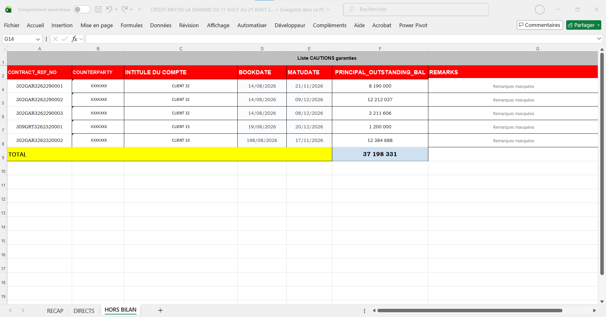
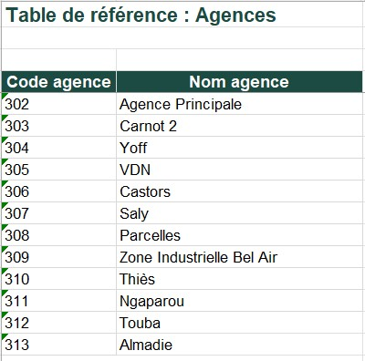
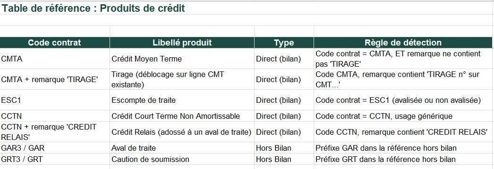
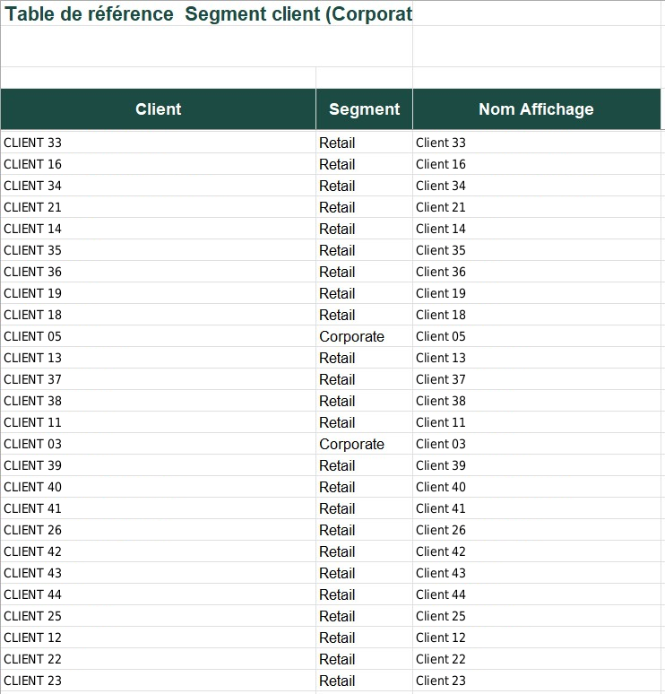
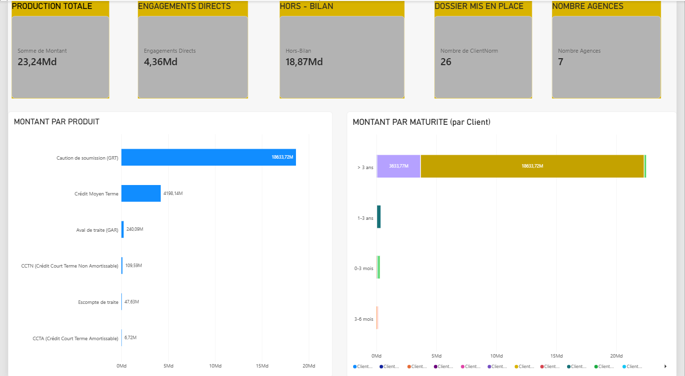
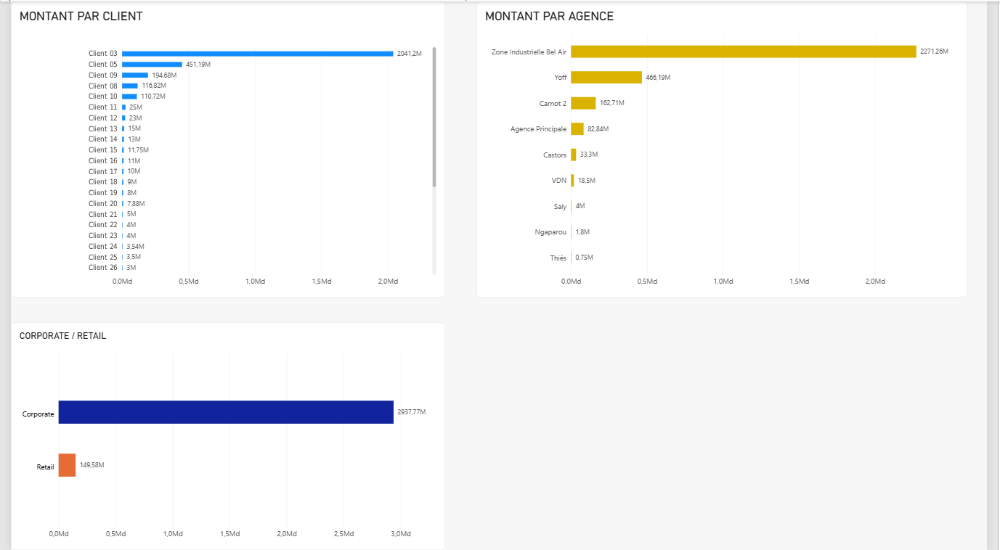
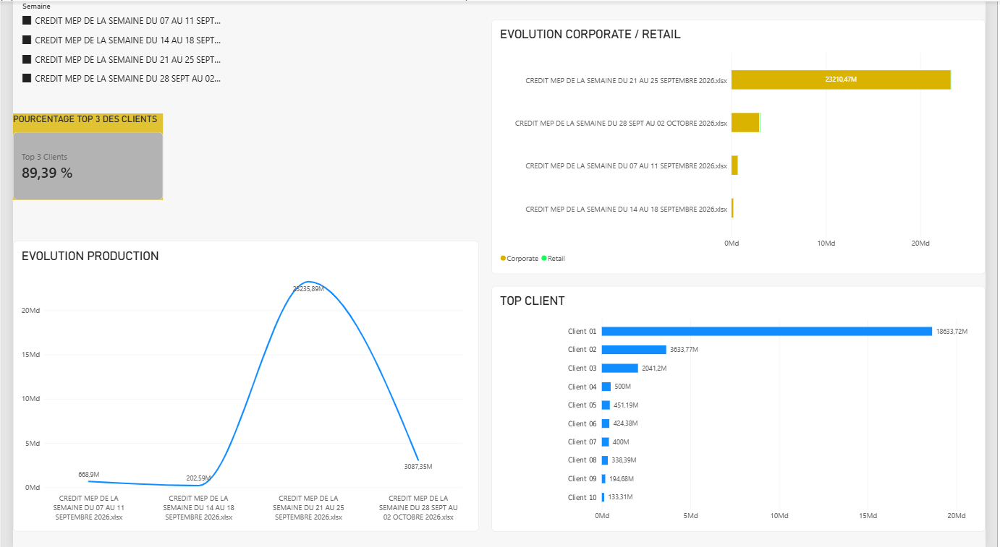

# Tableau de bord Power BI – Suivi hebdomadaire des mises en place de crédits

**Contexte :** Direction du Crédit – NSIA Banque Sénégal

## Problème : 
Chaque semaine, la Direction du Crédit de NSIA Banque Sénégal reçoit un fichier Excel listant
les crédits et engagements mis en place. Elle souhaite en tirer une vue claire de la production :
combien a été engagé, sur quels produits, pour quels clients, dans quelles agences et sur quelles
durées.Ces tableaux de bord étaient auparavant construits manuellement par les équipes, ce qui
demandait **4 à 5 heures** par semaine.

## Solution : 
J’ai conçu un rapport Power BI automatisé qui produit le même résultat en **moins de 5 minutes**.

## Objectifs du projet :
- automatiser la production du tableau de bord hebdomadaire
- appliquer des règles de classification identiques d’une semaine à l’autre
- rendre visibles les anomalies de données plutôt que de les masquer.

### Fonctionnalités principales
- Consolidation automatique de plusieurs fichiers Excel (DIRECTS + HORS BILAN)
- Classification des produits de crédit selon des règles métier (CMTA, ESC1, CCTN, GAR, GRT…)
- Calcul des tranches de maturité
- Enrichissement avec tables de référence (Agences + Segment client)
- Contrôles qualité explicites (« À CLASSER », « NON CLASSÉ », « INCONNU »)
- Indicateurs de concentration (part des 3 premiers clients)
- Vue photographie de la période + vue évolution hebdomadaire

### Stack technique
- **Power Query** : extraction, nettoyage, classification et consolidation
- **DAX** : mesures (Engagements Directs, Hors-bilan, Top 3 Clients, etc.)
- **Power BI** : restitution (2 pages principales)

  ### Impact
| Avant | Après |
|-------|-------|
| 4 à 5 heures / semaine | moins de 5 minutes |
| Règles variables selon la personne | Règles formalisées et identiques |
| Anomalies souvent masquées | Anomalies visibles et tracées |

## Architecture
1. Sources : fichiers hebdomadaires + tables de référence
2. Power Query : lecture, classification, contrôles qualité
3. Modèle + DAX
4. Rapport (2 pages)

## Confidentialité
Les données clients et les fichiers sources réels ne peuvent pas être partagés pour des raisons de confidentialité.  
Les captures d’écran présentées sont anonymisées.

## Captures d'écran

### Page 1 – RECAP : un récapitulatif (total des directs, total du hors-bilan, total général)


### Page 2 – DIRECTS (« Contrats mis en place ») : les crédits décaissés, au bilan


### Page 3 – HORS BILAN (« Cautions et garanties ») : les engagements de signature (avals, cautions),sans décaissement.


### Tables de référence

- **Table_Agences** jointure sur le code agence. Sans code (hors-bilan), la ligne reçoit « Non attribuable ». 
Un code absent de la table reçoit « INCONNU (code) - À AJOUTER DANS Table_Agences ».



- **Table Produits** Le code et les remarques sont comparés en majuscules.


- **Table Segment Client** jointure sur le nom normalisé du client. Un client absent de la table reçoit « À CLASSER ».


### Pages du rapport

- **la photographie de la période** Cinq indicateurs (production totale, engagements directs, hors-bilan, dossiers mis en place, nombre d’agences), puis les montants par produit, par maturité, par client, par agence et par segment.




- **l’évolution et la concentration** Sélecteur de semaine, évolution de la production
et de la répartition Corporate / Retail, principaux clients, et part des trois premiers clients.



## Mesures DAX principales

```dax
// Engagements directs 
Engagements Directs = 
CALCULATE(
    SUM(MEP_Consolide[Montant]),
    MEP_Consolide[TypeEngagement] = "Direct"
)

// Hors-bilan
Hors-Bilan = 
CALCULATE(
    SUM(MEP_Consolide[Montant]),
    MEP_Consolide[TypeEngagement] = "Hors Bilan"
)

// Nombre d’agences actives
Nombre Agences = 
CALCULATE(
    DISTINCTCOUNT(MEP_Consolide[Agence]),
    MEP_Consolide[Agence] <> "Non attribuable"
)

// Part des 3 premiers clients
Top 3 Clients = 
DIVIDE(
    CALCULATE(
        SUM(MEP_Consolide[Montant]),
        TOPN(
            3,
            VALUES(MEP_Consolide[ClientAffichage]),
            CALCULATE(SUM(MEP_Consolide[Montant]))
        )
    ),
    SUM(MEP_Consolide[Montant])
)
```

## Fonctions Power Query de classification
- **fn_produit** : Détermine le produit à partir du code et des remarques.
  
```dax
(code as nullable text, remark as nullable text) as text =>
let
c = Text.Upper(Text.Trim(code ?? "")),
r = Text.Upper(Text.Trim(remark ?? "")),
result =
if c = "CMTA" and Text.Contains(r, "TIRAGE") then "Crédit Moyen Terme"
else if c = "CMTA" then "Crédit Moyen Terme"
else if c = "ESC1" then "Escompte de traite"
else if c = "CCTN" then "CCTN (Crédit Court Terme Non Amortissable)"
else if c = "CCTA" then "CCTA (Crédit Court Terme Amortissable)"
else if Text.StartsWith(c, "GAR") then "Aval de traite (GAR)"
else if Text.StartsWith(c, "GRT") then "Caution de soumission (GRT)"
// Repli pour les lignes Hors Bilan sans référence contrat
else if c = "" and Text.Contains(r, "AVAL DE TRAITE") then "Aval de traite (GAR)"
else if c = "" and Text.Contains(r, "CAUTION") then "Caution de soumission (GRT)"
else if c = "" and Text.Contains(r, "RELAIS") then "CCTN (Crédit Court Terme Non Amortissable)"
else "NON CLASSÉ (code=" & c & ") - À VÉRIFIER"
in
result
```

- **fn_Bucket** : Range une durée en jours dans une tranche de maturité.
```dax
(days as nullable number) as text =>
let
result =
if days = null then "N/A (date invalide)"
else if days <= 90 then "0-3 mois"
else if days <= 180 then "3-6 mois"
else if days <= 365 then "6-12 mois"
else if days <= 1095 then "1-3 ans"
else "> 3 ans"
in
result
```

- **Requête de consolidation MEP_Consolide** : Le chemin du dossier local a été remplacé par un texte générique.
```dax
let
Source = Folder.Files("<chemin du dossier local MEP_Hebdomadaire>"),
ExcelFiles = Table.SelectRows(Source, each Text.EndsWith([Name], ".xlsx")),
ExtractOne = (fileContent as binary, fileName as text) as table =>
let
wb = Excel.Workbook(fileContent, null, true),
ProcessSheet = (sheetName as text, colRef as text, colClient as text,
colBooking as text, colMaturity as text, colBranch as nullable text,
colMontant as text, colRemark as text, typeEngagement as text) as table =>
let
raw = wb{[Item=sheetName, Kind="Sheet"]}[Data],
promoted = Table.PromoteHeaders(Table.Skip(raw, 1), [PromoteAllScalars=true]),
filtered = Table.SelectRows(promoted, each
Record.Field(_, colClient) <> null
and Text.Trim(Text.From(Record.Field(_, colClient))) <> ""
and Text.Upper(Text.Trim(Text.From(Record.Field(_, colClient)))) <> "TOTAL"
and Value.Is(Record.Field(_, colMontant), type number)),
withClient = Table.AddColumn(filtered, "ClientNorm", each
Text.Upper(Text.Trim(Text.Combine(Text.Split(Text.From(Record.Field(_, colClient)), " ")," ")))),
withCode = Table.AddColumn(withClient, "CodeProduit", each
let refv = Record.Field(_, colRef) in
if refv <> null and Text.Length(Text.From(refv)) >= 7
then Text.Middle(Text.From(refv), 3, 4) else ""),
withProduit = Table.AddColumn(withCode, "Produit", each
fnClassifyProduit([CodeProduit], Text.From(Record.Field(_, colRemark) ?? ""))),
withDays = Table.AddColumn(withProduit, "DureeJours", each
let
b = Record.Field(_, colBooking), m = Record.Field(_, colMaturity)
in
if Value.Is(b, type date) or Value.Is(b, type datetime) then
if Value.Is(m, type date) or Value.Is(m, type datetime) then
Duration.Days(Date.From(m) - Date.From(b))
else null
else null),
withBucket = Table.AddColumn(withDays, "MaturiteBucket", each fnBucket([DureeJours])),
withAgence = if colBranch <> null then
Table.AddColumn(withBucket, "AgenceCode", each Text.From(Record.Field(_, colBranch)))
else Table.AddColumn(withBucket, "AgenceCode", each null),
finalCols = Table.SelectColumns(
Table.AddColumn(Table.AddColumn(withAgence, "TypeEngagement", each typeEngagement),
"Montant", each Record.Field(_, colMontant)),
{"ClientNorm", "TypeEngagement", "Produit", "MaturiteBucket", "AgenceCode", "Montant"}
)
in
finalCols,
directs = ProcessSheet("DIRECTS", "CONTRACT_REF_NO", "INTITULE DU COMPTE ",
"BOOKING_DATE", "MATURITY_DATE", "BRANCH_CODE",
"PRINCIPAL_OUTSTANDING_BAL", "REMARKS", "Direct"),
horsBilan = ProcessSheet("HORS BILAN", "CONTRACT_REF_NO", "INTITULE DU COMPTE ",
"BOOKDATE", "MATUDATE", null,
"PRINCIPAL_OUTSTANDING_BAL", "REMARKS", "Hors Bilan"),
combined = Table.Combine({directs, horsBilan}),
withSemaine = Table.AddColumn(combined, "Semaine", each fileName)
in
withSemaine,
AllRows = Table.Combine(Table.TransformRows(ExcelFiles, each ExtractOne([Content], [Name]))),
MergedAgence = Table.NestedJoin(AllRows, {"AgenceCode"}, Table_Agences,
{"Code agence"}, "AgenceInfo", JoinKind.LeftOuter),
ExpandedAgence = Table.ExpandTableColumn(MergedAgence, "AgenceInfo", {"Nom agence"}),
AgenceFinale = Table.AddColumn(ExpandedAgence, "Agence", each
if [AgenceCode] = null then "Non attribuable"
else if [Nom agence] = null then "INCONNU (" & [AgenceCode] & ") - À AJOUTER DANS Table_Agences"
else [Nom agence]),
MergedSegment = Table.NestedJoin(AgenceFinale, {"ClientNorm"}, Table_ClientsSegment,
{"Client"}, "SegInfo", JoinKind.LeftOuter),
ExpandedSegment = Table.ExpandTableColumn(MergedSegment, "SegInfo", {"Segment", "Nom Affichage"}),
SegmentFinal = Table.AddColumn(ExpandedSegment, "SegmentFinal", each
if [Segment] = null then "À CLASSER" else [Segment]),
ClientAffichageFinal = Table.AddColumn(SegmentFinal, "ClientAffichage", each
if [Nom Affichage] = null then [ClientNorm] else [Nom Affichage]),
Result = Table.SelectColumns(ClientAffichageFinal, {"Semaine", "TypeEngagement",
"ClientNorm", "ClientAffichage", "SegmentFinal", "Produit", "Agence",
"MaturiteBucket", "Montant"}),
TypesForces = Table.TransformColumnTypes(Result, {
{"Montant", type number}, {"Semaine", type text}, {"TypeEngagement", type text},
{"ClientNorm", type text}, {"ClientAffichage", type text}, {"SegmentFinal", type text},
{"Produit", type text}, {"Agence", type text}, {"MaturiteBucket", type text}
})
in
TypesForces
```
  

